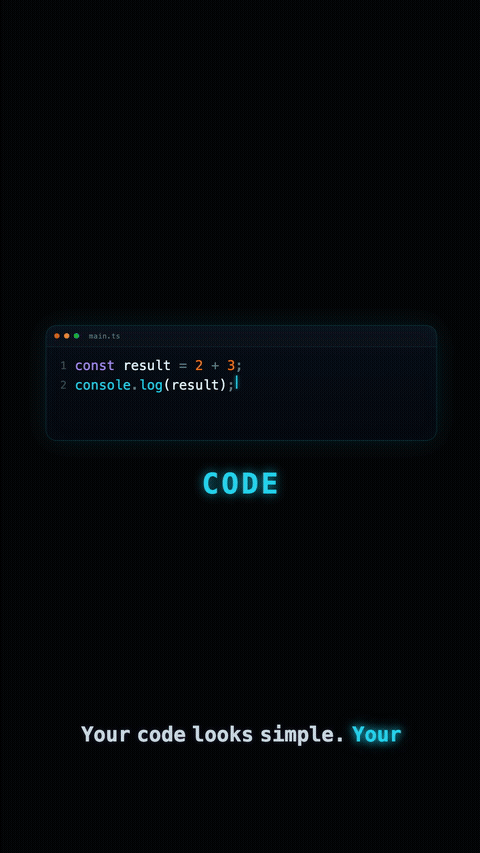

<h1 align="center">🎬 Code-to-Video</h1>

<p align="center">
  <b>Write a scene as a React component. Get back a narrated, captioned, rendered MP4.</b>
  <br />
  A code-first motion graphics pipeline built on <a href="https://remotion.dev">Remotion</a> — no timeline editor, no manual keyframing, no recording a voiceover by hand.
</p>

<p align="center">
  
  
  
  
  
  
</p>

<p align="center">
  
</p>

<p align="center">
  <sub>🔴 Live preview, autoplays on page load · 10s excerpt of <code>out/code-to-electricity.mp4</code> (60s, 1080×1920)</sub>
  <br />
  <sub>GitHub can't autoplay an .mp4 inline, so this GIF <i>is</i> the rendered video — same pixels, no re-encode trick. <a href="out/code-to-electricity.mp4">⬇ Download the full MP4 with audio</a></sub>
</p>

<p align="center">
  <code>npm i</code> → <code>npm run dev</code> to scrub it live, or <code>npx remotion render</code> to re-render it yourself.
</p>

---

## 📖 What this project actually is

This is **not** a generic Remotion starter. It's an opinionated pattern for building short-form explainer videos where:

- 🧩 **Scenes are React components.** Each beat of the video (`Scene01Hook.tsx`, `Scene02Code.tsx`, … `Scene07CTA.tsx`) is an isolated, frame-driven component under `src/scenes/`. Timing, animation curves, and layout live in code, reviewable in a PR like any other component.
- ⏱️ **The timeline is data, not a GUI.** `src/data/scenes.ts` is the single source of truth for how long each scene plays and in what order, expressed in seconds/frames at 30fps. Changing pacing means editing an object, not dragging a clip.
- 🔀 **Transitions are declarative.** `src/compositions/CodeToElectricity.tsx` stitches scenes together with `@remotion/transitions` (`TransitionSeries`), choosing a different presentation per cut — wipe, fade, slide — matched to the story beat it connects.
- 🗣️ **Narration is AI-generated and swappable.** `scripts/generate-narration.ts` calls the ElevenLabs API to synthesize voiceover for every scene's line of narration, and captures ElevenLabs' own character-level timestamp alignment to build **word-accurate captions** — not estimated, not hand-typed. Multiple voices can be generated side-by-side and A/B'd from Remotion Studio's Composition Props panel without re-rendering code.
- 🎨 **Reusable visual primitives live in `src/components/`** — things like `CodeEditor`, `BinaryStream`, `LogicGate`, `Transistor`, `Chip`, `CircuitTrace`, `Caption`, and `SceneTransition` — so new scenes compose from the same visual language instead of reinventing effects.

The deliverable isn't "a video." It's a **repeatable system for producing vertical explainer videos** where every frame, cut, and spoken word is version-controlled, diffable, and regenerable.

---

## 🎯 Why this exists

Producing a polished 60-second vertical explainer with a traditional toolchain (After Effects + a separate TTS tool + a separate caption tool + manual sync) is slow and non-reproducible: timing lives in a `.aep` binary blob, voiceover is a one-off recording, and captions are usually eyeballed. Iterating on pacing means re-opening a GUI project and re-exporting.

Code-to-Video collapses that whole pipeline into one codebase:

| 🐌 Traditional pipeline | ⚡ Code-to-Video |
|---|---|
| Hand-animate in After Effects | Animate with React + Remotion's frame-based interpolation |
| Record/outsource voiceover | Generate narration via ElevenLabs API, versioned per scene |
| Manually time captions to audio | Captions derived automatically from TTS character-timestamp alignment |
| Binary project file, hard to diff/review | Plain TypeScript/TSX, reviewable in git |
| Re-export whole video for any tweak | Change one scene's props/timing, re-render just that composition |
| One fixed voice/cut baked in | Swap voice via a prop; swap transitions/durations via config |

It's built for anyone who wants to produce a **series** of similar short-form videos (a recurring explainer format, a weekly "how X works" Reel, a product-feature teaser) without re-paying the manual production cost every time.

---

## 🏗️ How it works (architecture)

```
src/
├── index.ts                      # Remotion entry point
├── Root.tsx                      # Registers the <Composition> (id, fps, size, duration, default props)
├── compositions/
│   └── CodeToElectricity.tsx     # Stitches all scenes via <TransitionSeries>, assigns per-cut transitions
├── scenes/
│   ├── Scene01Hook.tsx           # "Wait, what actually happens here?"
│   ├── Scene02Code.tsx           # Code editor mock, line of code appears
│   ├── Scene03Binary.tsx         # Code dissolves into a binary stream
│   ├── Scene04Transistors.tsx    # Binary flows through chip/transistor visuals
│   ├── Scene05Calculation.tsx    # Logic gates animate a computation
│   ├── Scene06Reveal.tsx         # The answer (2 + 3 = 5) is revealed
│   └── Scene07CTA.tsx            # "Follow for more" call to action
├── components/                   # Shared visual primitives used across scenes
│   ├── CodeEditor.tsx  BinaryStream.tsx  LogicGate.tsx  Transistor.tsx
│   ├── Chip.tsx  CircuitTrace.tsx  Caption.tsx  SceneTransition.tsx  TransitionSfx.tsx
└── data/
    ├── scenes.ts                 # Frame-accurate timeline: scene order + durations + transition padding
    ├── narration.ts              # Source-of-truth narration script per scene (plain English lines)
    ├── useNarration.ts           # Resolves {voiceId, sceneId} -> {audioSrc, captions}
    ├── voice-map.json            # Human voice name -> ElevenLabs voice ID (generated)
    └── generated-captions.json   # Word-level Caption[] per voice per scene (generated, from real TTS timestamps)

scripts/
└── generate-narration.ts         # CLI: calls ElevenLabs TTS+alignment API, writes audio + captions

public/
├── voiceover/CodeToElectricity/<voiceId>/<sceneId>.mp3   # Generated narration audio, one file per scene per voice
└── preview/code-to-video-preview.gif                      # README preview clip (generated from the rendered MP4)

out/
└── code-to-electricity.mp4       # Rendered final video (gitignored; produced by `remotion render`)
```

### 🎞️ The rendering model

Remotion renders video as a **pure function of frame number**. Every scene component reads the current frame (via `useCurrentFrame()`) and derives all animation, text reveals, and layout from it — deterministically. This is what makes the video renderable headlessly to MP4: there's no "recording," just evaluating the React tree at every frame and compositing frames into video.

### 🔀 The transition model

`src/data/scenes.ts` defines:
- `VIDEO_FPS` (30), `VIDEO_WIDTH`/`VIDEO_HEIGHT` (1080×1920 — vertical), `VIDEO_DURATION_IN_FRAMES` (1800 = 60s)
- `TRANSITION_FRAMES` (15) — every cut between scenes overlaps by this many frames
- `SCENES` — an ordered array of `{ id, label, durationInFrames }`, where each non-final scene's duration is padded by `TRANSITION_FRAMES` so the *rendered* total still lands exactly on 1800 frames despite the overlap eaten by transitions

`CodeToElectricity.tsx` then renders every scene inside `<TransitionSeries.Sequence>`, with a `<TransitionSeries.Transition>` between each pair choosing a presentation (`wipe`, `fade`, or `slide`) picked to match the narrative beat.

### 🗣️ The narration + captions model

1. `src/data/narration.ts` holds the plain-English script, one line per scene — the single source of truth for what gets spoken.
2. `scripts/generate-narration.ts` is run manually (it costs API calls, so it's not wired into the render pipeline automatically). For each `--voice` name you pass, it:
   - Looks up that name against your actual ElevenLabs voice library (never hardcodes voice IDs — those are account-specific).
   - Calls ElevenLabs' `/v1/text-to-speech/{voice_id}/with-timestamps` endpoint, which returns both the synthesized audio **and** character-level start/end timestamps.
   - Writes the MP3 to `public/voiceover/CodeToElectricity/<voiceId>/<sceneId>.mp3`.
   - Converts the character-level alignment into word-level `Caption[]` objects (grouping characters between whitespace, using the TTS engine's own timing — not guessed) and merges them into `src/data/generated-captions.json`.
   - Skips any `(voice, scene)` pair that's already generated, unless `--force` is passed — so adding a new voice never re-pays for voices you already have.
3. `src/data/useNarration.ts` (`getSceneNarration(voiceId, sceneId)`) resolves a scene's audio file + captions for whichever voice is active, and explicitly returns "no audio" if that pair hasn't been generated yet — scenes never silently assume narration exists.
4. `CodeToElectricity`'s `voiceId` prop (default set by `DEFAULT_VOICE_ID`, overridable per-render or live in Studio's Composition Props panel) flows down to every scene, so the **same cut and animation timing can be A/B'd across multiple narrator voices** with zero re-rendering of visuals — only new audio generation.

---

## ✨ Features

| | |
|---|---|
| 📱 **Vertical, social-ready format** | 1080×1920 @ 30fps, tuned for Instagram Reels / YouTube Shorts / TikTok out of the box. |
| ⏱️ **Fully declarative scene timeline** | Add, reorder, retime, or remove scenes by editing one typed config object (`scenes.ts`); the final video duration self-corrects. |
| 🔀 **Per-cut transition design** | Wipe / fade / slide (via `@remotion/transitions`), chosen per transition rather than one global default. |
| 🗣️ **AI narration via ElevenLabs** | Any voice in your ElevenLabs library can be generated by name; supports generating and comparing multiple voices without extra cost for voices already rendered. |
| 💬 **Word-accurate captions for free** | Captions come from the TTS engine's actual character timestamps, so on-screen text is synced to the real audio, not an approximation. |
| 🎨 **Reusable animated primitives** | Code editor mock, binary digit stream, logic gate, transistor, chip, circuit trace, caption renderer, scene-transition wrapper, and transition sound effects. |
| 👀 **Live, scrubbable preview** | Remotion Studio (`npm run dev`) gives a frame-accurate timeline scrubber, Composition Props panel (e.g. to swap `voiceId` live), and hot reload on every save. |
| 🤖 **Deterministic, scriptable rendering** | `remotion render` / `remotion bundle` produce the same MP4 every time from the same code + data, with no manual export step. |
| ⚙️ **Config-level render tuning** | `remotion.config.ts` sets the Rspack bundler, JPEG frame image format (faster renders), output overwrite behavior, and a 2-second premount window so heavier scenes are warmed up before they're shown. |
| 🧪 **TypeScript end-to-end** | Scenes, data, and the narration script are fully typed (`SceneId` is a shared union type), so renaming/removing a scene is a compile error everywhere it's still referenced. |
| ✅ **Clean lint/typecheck gate** | `npm run lint` runs ESLint (via `@remotion/eslint-config-flat`) and `tsc` together. |

---

## ⚙️ Prerequisites

- **Node.js** 18+ (the narration script uses Node's native TypeScript stripping — `node --experimental-strip-types` — which needs a reasonably recent Node; Node 22+ recommended).
- **npm** (repo ships a `package-lock.json`).
- **FFmpeg** is bundled/managed by Remotion itself — no separate install needed.
- **An ElevenLabs account + API key** — only required if you want to (re)generate narration audio/captions. The repo already ships pre-generated audio/captions for the default voice, so you can render the example video with **zero** API key setup.

---

## 🚀 Getting started

### 1️⃣ Install

```bash
npm i --loglevel=error
```

### 2️⃣ Preview in Remotion Studio (recommended first step)

```bash
npm run dev
```

This opens Remotion Studio in your browser with a scrubbable timeline for the `CodeToElectricity` composition. Use the **Composition Props** panel to swap `voiceId` between any voices you've generated (see below). Edits to any scene file hot-reload instantly.

### 3️⃣ Render the final MP4

```bash
npx remotion render
```

This renders the registered `CodeToElectricity` composition to `out/code-to-electricity.mp4` (the `out/` directory is gitignored — rendered output is a build artifact, not something to commit). To render explicitly:

```bash
npx remotion render CodeToElectricity out/code-to-electricity.mp4
```

Useful flags:

```bash
npx remotion render CodeToElectricity out/my-cut.mp4 --props='{"voiceId":"<some-other-voice-id>"}'
npx remotion render CodeToElectricity out/preview.mp4 --frames=0-150   # render just a range while iterating
```

### 4️⃣ Type-check and lint

```bash
npm run lint
```

### 5️⃣ Upgrade Remotion

```bash
npm run upgrade
```

---

## 🔑 Adding your own ElevenLabs API key

1. Get an API key from the [ElevenLabs dashboard](https://elevenlabs.io) → Profile → API Keys.
2. Create (or edit) the `.env` file in the project root:

   ```bash
   ELEVENLABS_API_KEY=your_key_here
   ```

   `.env` is already gitignored — it will never be committed.
3. Generate narration + captions for a voice in your ElevenLabs library (use the voice's **display name**, exactly as it appears in your ElevenLabs voice library, e.g. `Adam`, `Rachel`):

   ```bash
   node --env-file=.env --experimental-strip-types scripts/generate-narration.ts --voice Adam
   ```

   Generate multiple voices in one run to A/B them later:

   ```bash
   node --env-file=.env --experimental-strip-types scripts/generate-narration.ts --voice Adam --voice Rachel
   ```

   Force-regenerate audio that already exists (e.g. after editing `narration.ts`):

   ```bash
   node --env-file=.env --experimental-strip-types scripts/generate-narration.ts --voice Adam --force
   ```

4. The script writes:
   - `public/voiceover/CodeToElectricity/<voiceId>/<sceneId>.mp3` — one MP3 per scene
   - Updates `src/data/generated-captions.json` — word-level captions with real timestamps
   - Updates `src/data/voice-map.json` — maps the human-readable voice name to its ElevenLabs voice ID
5. Open `npm run dev`, go to Composition Props, and switch `voiceId` to try the new voice — no restart needed.

> 💡 The script only calls the API for `(voice, scene)` pairs not already on disk, so re-running it after adding a new scene's narration line costs nothing for scenes you've already generated.

---

## 🎥 Creating your own video

The example "Code Becomes Electricity" video is a template for building a different video using the same pipeline:

1. **Write the script.** Decide your scenes and write one short narration line per scene in `src/data/narration.ts` (and mirror it into `scripts/generate-narration.ts`'s `NARRATION_SCRIPT` — the script intentionally keeps its own literal copy, since Node's native TS-stripping mode can't import from `src/`; the comment at the top of that file explains why).
2. **Define the timeline.** In `src/data/scenes.ts`, list your scene IDs in `SCENE_ORDER` and give each a `durationInFrames` in `BASE_DURATIONS` (use the `seconds()` helper). Total video length and per-scene padding are computed automatically.
3. **Build each scene as a component.** Add a new file under `src/scenes/`, e.g. `Scene01Intro.tsx`. Inside, use `useCurrentFrame()` / `interpolate()` / `spring()` from `remotion` to drive animation off the frame number — never off wall-clock time. Reuse or extend the primitives in `src/components/` (or add new ones there if a visual effect will be reused across scenes).
4. **Wire narration into the scene.** Call `getSceneNarration(voiceId, sceneId)` from `src/data/useNarration.ts` to get `{ audioSrc, captions }`, play `audioSrc` with Remotion's `<Audio>`, and render `captions` with the `Caption` component (or `@remotion/captions` utilities) so on-screen text tracks the voice.
5. **Register the scene in the composition.** Add it to `SCENE_CONTENT` and insert a `<TransitionSeries.Sequence>` + `<TransitionSeries.Transition>` pair for it in `src/compositions/CodeToElectricity.tsx` (or build an entirely new composition file and register it in `src/Root.tsx` with its own `<Composition>` if you're making an unrelated video rather than editing this one).
6. **Generate narration audio** for your new/changed lines (see above).
7. **Preview** with `npm run dev`, iterate on timing/animation with hot reload.
8. **Render** with `npx remotion render` once you're happy.

To start a **brand-new, unrelated video** (different composition, not just new scenes in this one), duplicate the pattern: new folder under `src/scenes/` + a new file under `src/compositions/`, then register it as a second `<Composition id="...">` in `src/Root.tsx` with its own width/height/fps/duration.

---

## 🧩 Configuration reference

**`remotion.config.ts`**
- `Config.setRspack(true)` — uses Rspack (faster) instead of Webpack for bundling.
- `Config.setVideoImageFormat("jpeg")` — faster, smaller intermediate frames than PNG (no alpha needed here).
- `Config.setOverwriteOutput(true)` — re-renders overwrite `out/` without prompting.
- `Config.setDefaultPremountInSeconds(2)` — mounts each scene 2 seconds before it's shown, so video/audio/fonts are warmed up and don't stutter on cut-in.

**`src/data/scenes.ts`**
- `VIDEO_FPS`, `VIDEO_WIDTH`, `VIDEO_HEIGHT`, `VIDEO_DURATION_IN_FRAMES` — top-level video format.
- `TRANSITION_FRAMES` — overlap length (in frames) for every cut.
- `BASE_DURATIONS` / `SCENE_ORDER` — edit these two to change pacing or scene order.

**`.env`**
- `ELEVENLABS_API_KEY` — required only for `scripts/generate-narration.ts`.

---

## 📌 Project status

The example composition (`CodeToElectricity`) is complete and renders end-to-end: 7 scenes, 3 transition styles, full narration + word-synced captions for the default voice, rendered to `out/code-to-electricity.mp4`. The pipeline (scene timeline, transition stitching, narration generation, caption sync) is the reusable part — treat the 7 existing scenes as a worked example, not a fixed requirement, when building a new video.

<p align="center">
  <sub>Built using <a href="https://remotion.dev">Remotion</a> + <a href="https://elevenlabs.io">ElevenLabs</a></sub>
</p>
